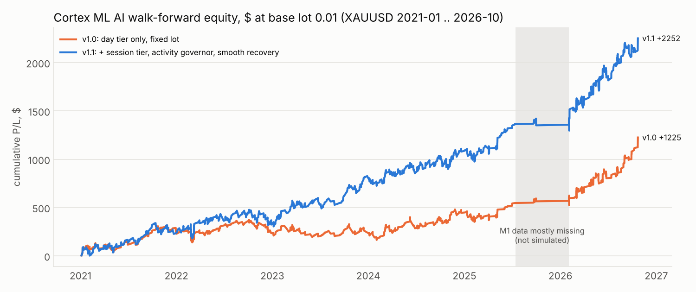
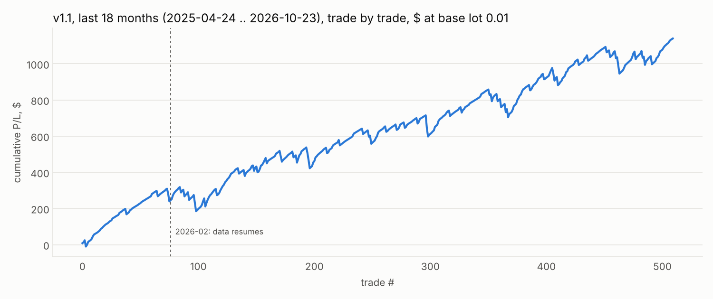
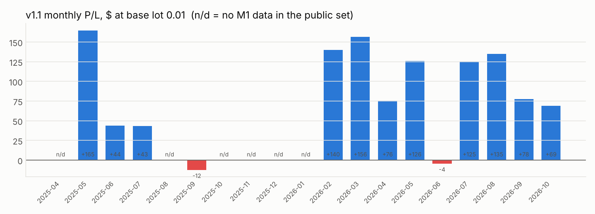
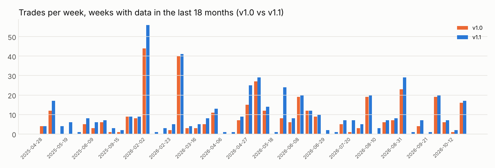

# Cortex ML AI 1.10: советник для XAUUSD (MT5 и MT4)

Советник торгует золото **по направлению сильного внутридневного движения**.
Две онлайн-модели машинного обучения каждый месяц переобучаются на истории
брокера и на результатах собственных реальных сделок.

| Параметр | Значение |
|---|---|
| Жёсткий стоп | **$30** |
| Тейк | **$12–15** (по умолчанию 13.5) |
| Трейлинг Adaptive Profit Shield | фиксирует не меньше **$3** |
| Регулятор активности | не даёт советнику неделями молчать |
| Плавное восстановление | после убытка лот немного растёт и распределяет недостачу на ~15 сделок |

**MT5 и MT4 используют одно и то же ядро** `CortexCore.mqh`, поэтому сигналы,
модели, трейлинг и восстановление одинаковы. Различается только отправка ордеров.

Все суммы указаны в долларах цены XAUUSD, то есть в долларах прибыли на
**0.01 лота**.

> Исследовательский результат, не обещание доходности. Ниже честно расписано,
> на каких данных он получен и что нужно перепроверить в тестере на тиках брокера.

---

## 1. Что внутри

### Сигналы: три уровня

| Уровень | Когда срабатывает | Решение |
|---|---|---|
| **Ядро** | движение дня от открытия ≥ **1.0 дневного ATR** | вход по направлению дня, если модель №1 не против (`p > base − 0.03`) |
| **ML-уровень** | движение дня 0.6–1.0 ATR | вход, только если модель №1 уверена (`p > base + 0.04`) |
| **Сессионный уровень** (новое в 1.1) | день спокойный (≤ 0.6 ATR), но за 6 ч цена прошла > 3 часовых ATR или за 24 ч > 7 | вход по направлению импульса, если **отдельная модель №2** уверена (`p > base + 0.04`) |

Опорный эффект — внутридневной моментум. Торговля по направлению сильного
дня прибыльна во всех годах 2020–2026, против — убыточна в каждом году.
Классические сетапы (откаты, Боллинджер, пробои, свипы, круглые уровни)
устойчивого преимущества на барьерах SL 30 / TP 13 **не** показали.

### Машинное обучение

- **Самообучение.** Советник сам размечает историю брокера. Для каждого
  прошлого сигнала он прогоняет **свою логику сопровождения** (SL / TP / щит)
  по M1-барам и получает пример «67 признаков → исход сделки».
- **Признаки.** Блоки M15 / H1 / H4 / D1: доходности в ATR, расстояния до
  EMA 20/50/200, RSI, Боллинджер, положение в диапазоне, тренд/флэт,
  волатильность, свечи, контекст дня, час, день недели.
- **Две модели** L2-логистической регрессии (решатель Ньютона, совпадает со
  sklearn до 1e-6). Модели переобучаются **раз в месяц** на скользящем окне
  3 года.
- **Учёт реальных сделок.** Фактический результат каждой закрытой сделки
  возвращается в обучение. В реальной торговле память хранится в
  `Common\Files\CortexML\`.

### Регулятор активности (новое в 1.1)

Если советник **1.5 дня** не входил в рынок, требования к уверенности моделей
(запас 0.04) плавно снижаются за 2 дня до нуля. Он берёт сигналы, где модель
видит хоть какое-то положительное преимущество, но **никогда не торгует
сигналы с отрицательным преимуществом**. Ядро от этого не меняется.

### Плавное восстановление после убытка (новое в 1.1)

- Советник считает свою недостачу под максимумом прибыли (high-water mark) и
  распределяет её на **~15 будущих сделок**:

  `множитель лота = 1 + недостача / (15 × $6)`, не больше **×1.5**.

  После стопа −$30 следующие сделки идут лотом ×1.33, после двух стопов — ×1.5.
- Как только советник выходит на новый максимум, лот возвращается к базовому.
- Почему так: выигрышных сделок ~90%, поэтому за стопом чаще всего идут
  прибыльные сделки, и умеренное увеличение лота ускоряет возврат. Это не
  мартингейл: лот растёт плавно и ограничен потолком.
- Проверенный вариант «увеличить плотность» (больше позиций или ниже порог
  в просадке) дал худшее соотношение прибыли к риску и отброшен.
- Отключается параметром `InpRecovery=false`.

### Adaptive Profit Shield (трейлинг)

| Профиль | Старт | Фиксация | Дистанция | Около TP |
|---|---|---|---|---|
| **Shield (по умолчанию)** | +$5 | **+$4** | $3 от пика | при ≥ 80% TP дистанция × 0.6 |
| Balanced | +$6 | +$4 | $3 | так же |
| Runner | +$8 | +$5 | $3 | так же |
| Custom | свой | ≥ $3 | свой | так же |

- Стоп двигается только вперёд и только шагом от $0.5.
- Минимальная фиксация $3 (по умолчанию $4).
- Жёсткий SL и TP стоят на сервере с момента открытия.

---

## 2. Результаты (walk-forward, в $ при базовом лоте 0.01)

Модель для каждого месяца обучена только на сделках, закрытых до его начала.
Издержки: спред $0.25 и комиссия $7 за лот. Одна позиция одновременно.

| Версия | Период | Сделок в неделю | Пустых недель | Прибыль | PF | Макс. просадка | Прибыль / просадка |
|---|---|---|---|---|---|---|---|
| v1.0 | 18 мес. | 7.6 | 26% | +$819 | 1.67 | $106 | 7.7 |
| **v1.1 (по умолчанию)** | **18 мес.** | **10.2** | **0%** | **+$1140** | **1.53** | **$154** | **7.4** |
| v1.0 | 2021–2026 | 4.2 | 15.5% | +$1225 | 1.29 | $209 | 5.9 |
| **v1.1 (по умолчанию)** | **2021–2026** | **5.7** | **1.1%** | **+$2252** | **1.31** | **$173** | **13.0** |

- v1.1 по годам 2021…2026: +239, +85, +503, +258, +267, +900, все годы в плюсе.
- Без восстановления v1.1 даёт +$889 за 18 месяцев (PF 1.49, просадка $118)
  и +$1560 за 2021–2026 (просадка $145).
- «18 мес.» — это 2025-04-24…2026-10-23. Из них реально посчитано около
  10–11 месяцев, остальное — дыра в данных (раздел 4).






### Профили трейлинга

Посчитано на движке v1.0, фиксированный лот, `docs/profiles.csv`.

| Профиль | 2021–2026: прибыль / PF | 18 мес.: прибыль / PF / просадка |
|---|---|---|
| **Shield 5/4/3** | +1225 / 1.29 | +819 / 1.67 / 106 |
| Balanced 6/4/3 | +933 / 1.21 | +566 / 1.41 / 141 |
| Runner 8/5/3 | +697 / 1.14 | +421 / 1.27 / 305 |
| Без трейлинга (TP 13.5 / SL 30) | +395 / 1.07 | +189 / 1.09 / 382 |
| Shield, спред $0.40 (стресс) | +1100 / 1.26 | +676 / 1.52 / 111 |

---

## 3. Установка

### MT5

1. Скопируй `MQL5/Experts/CortexML/` (оба файла: `CortexML_AI.mq5` и
   `CortexCore.mqh`) в `MQL5\Experts\CortexML\`.
2. Скопируй пресеты `MQL5/Presets/*.set` в `MQL5\Presets\`.
3. Скомпилируй `CortexML_AI.mq5` (F7).
4. Повесь советник на график XAUUSD, любой таймфрейм.
5. Сервис → Настройки → Графики → «Макс. баров в окне» = **Unlimited**.

### MT4

1. Скопируй `MQL4/Experts/CortexML/` (оба файла: `CortexML_AI.mq4` и
   `CortexCore.mqh`) в `MQL4\Experts\CortexML\`.
2. Скопируй пресеты `MQL4/Presets/*.set` в `MQL4\Presets\`.
3. Скомпилируй `CortexML_AI.mq4`.
4. Сервис → Настройки → Графики:
   - «Макс. баров в истории» — максимум (например 5000000);
   - «Макс. баров в окне» — тоже побольше.
5. Загрузи историю XAUUSD на **M1, M5, M15 и H1** (Сервис → Архив котировок, F2).
   Модель учится на минутках: без M1/M5-истории она будет работать только
   по правилу ядра.
6. Для market execution брокеров советник сам откроет сделку без стопов и сразу
   их выставит, если брокер не принимает SL/TP в запросе на открытие.

### Время сервера

По умолчанию стоит брокер NY+7: GMT+2 зимой и +3 летом, переход по США
(IC Markets, Pepperstone, RoboForex и др.). Для брокера GMT+0 поставь
`InpServerGMTWinter=0` и `InpServerUsDst=false`.

### Пресеты

| Файл | Что это |
|---|---|
| `CortexML_Default.set` | v1.1 по умолчанию: 0.01 лота, восстановление и активность включены |
| `CortexML_Conservative_NoRecovery.set` | поведение v1.0: без сессионного уровня, регулятора и восстановления |
| `CortexML_AutoLot_1000.set` | 0.01 лота на каждые $1000 баланса, дневной лимит убытка 6% |
| `CortexML_Risk1pct.set` | риск 1% баланса до стопа, дневной лимит 4% |
| `CortexML_Balanced_Trail.set` | трейлинг Balanced |
| `CortexML_Runner_Trail.set` | трейлинг Runner |

### Капитал

Ориентир: **от $1000 на каждые 0.01 лота**. Историческая максимальная
просадка v1.1 на 0.01 лота: $154 за последние 18 месяцев и $173 за 2021–2026.
Режим восстановления добавляет к лоту в просадке до 50%.

---

## 4. Данные и ограничения: прочитай обязательно

- **Источники.** Котировки собраны из публичных наборов на GitHub (прямой доступ
  к Dukascopy из среды разработки закрыт). Часовые пояса сверены, корреляция
  0.96–0.98.
- **Дыра в данных.** С июля 2025 по январь 2026 в публичных данных есть только
  часовые бары, этот кусок **не симулирован**. В апреле–июле 2025 минутки
  дырявые. Финальная проверка — **тестер на тиках брокера** (раздел 5).
- **Перенос на MQL.**
  - Признаки из алгоритмов советника, переписанных на Python, совпадают с
    исследованием до ~1e-5 (`research/mql_port.py`).
  - Решатель модели совпадает со sklearn до 1e-6.
  - Скомпилировать MQL5/MQL4 в среде разработки было негде: первая компиляция
    у тебя. Если MetaEditor выдаст ошибки, пришли их, я исправлю.
- **Риски.**
  - Средний выигрыш около $6 при стопе $30, серия стопов подряд возможна.
  - В режиме восстановления лот в просадке выше базового.
  - Спред в новости шире: работает фильтр `InpMaxSpreadUSD`.

---

## 5. Как проверить в тестере

### MT5

В тестере MT5 доступна история примерно за год до старта. Поэтому тест
запускается **с 2023-04-24** для прогрева модели, а торговля идёт **с
2025-04-24** (параметр `InpTradeStart`).

| ini (`tester/mt5/`) | Что делает |
|---|---|
| `cortex_last18_realticks.ini` | 18 мес., реальные тики, депозит $1000, 0.01 лота |
| `cortex_last18_m1ohlc.ini` | то же, быстрый режим «1 minute OHLC» |
| `cortex_last18_fixedlot_norecovery.ini` | контроль: без восстановления |
| `cortex_last18_v10_compat.ini` | контроль: поведение v1.0 |
| `cortex_full_2021_2026.ini` | весь период 2021–2026 |

Для `run.sh`: положи ini в `ini\` рядом с советником и в переменной `U` замени
`HDF` на `CortexML`.

### MT4

| Файлы (`tester/mt4/`) | Что делает |
|---|---|
| `cortex_mt4_last18.ini` + `.set` | 18 мес., «Every tick» |
| `cortex_mt4_last18_norecovery.ini` + `.set` | контроль без восстановления |

- Запуск: `terminal.exe /config:cortex_mt4_last18.ini`.
- `.set` положи в папку `tester\` терминала.
- В MT4 история до старта не ограничена, прогрев не нужен.

### Ориентиры

- PF за 18 месяцев от ~1.3;
- win rate 85–90%;
- 8–10 сделок в неделю при высокой волатильности золота;
- просадка на 0.01 лота в пределах $150–300.

---

## 6. Состав папки

```
ea/cortex-ml-ai/
  core/CortexCore.mqh               общее ядро (эталон) -> sync_core.sh копирует в обе платформы
  MQL5/Experts/CortexML/            CortexML_AI.mq5 + CortexCore.mqh
  MQL4/Experts/CortexML/            CortexML_AI.mq4 + CortexCore.mqh
  MQL5/Presets, MQL4/Presets        пресеты
  tester/mt5, tester/mt4            конфиги тестера
  docs/                             графики и таблицы
  research/                         воспроизводимое исследование (Python)
    build_dataset.py                сборка котировок из публичных источников
    features.py, engine.py          признаки и точный симулятор сделки на M1
    prepare.py                      кандидаты + разметка исходов
    wf_predict.py                   walk-forward прогнозы моделей
    activity_recovery.py            исследование активности и режимов восстановления
    reference_v2.py                 эталонная симуляция v1.1
    mql_port.py                     проверка паритета MQL ↔ Python
```
